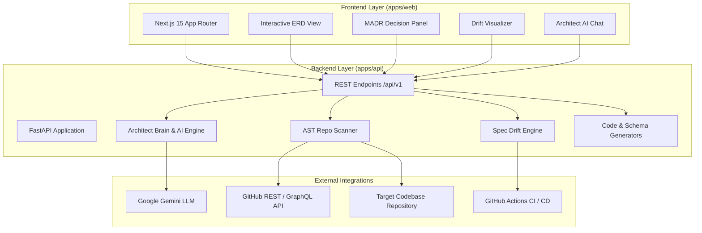

<div align="center">

# 📐 CreateFrame 

**The Technical Control Plane for Modern Software Builders**  
*Architect before you code. Maintain living specifications, detect schema drift, and sync directly with GitHub.*


[](https://fastapi.tiangolo.com)
[](https://nextjs.org)
[](https://python.org)
[](https://www.typescriptlang.org)
[](LICENSE)

</div>

---

## 📖 Overview

**CreateFrame** is an architecture-first engineering platform that turns software specifications into living, verifiable control systems. Rather than treating technical design docs and database diagrams as static artifacts that go obsolete immediately after coding begins, CreateFrame couples your architectural models, API contracts, and Architectural Decision Records (ADRs) directly with your GitHub codebase.

Whether scaffolding a greenfield microservice or managing legacy service evolution, CreateFrame gives teams a single control plane to visualize relationships, run AI-assisted architectural reviews, detect code drift in CI/CD, and push synchronized contracts to Git.

---

## ✨ Core Features

### 1. 📊 Interactive Entity Relationship Diagrams (ERD)
- Visual data modeling powered by reactive Mermaid diagrams with zoom, pan, and table inspector.
- Real-time relation cardinality support (`1:1`, `1:N`, `N:M`), primary/foreign keys, and data type validation.
- Direct export into production-ready **Prisma Schemas**, **SQL DDL (PostgreSQL / SQLite)**, and **SQLAlchemy Models**.

### 2. ⚡ Continuous Code Drift Detection
- **AST-Powered Code Inspection**: Scans Python (FastAPI, Django, Flask) and TypeScript/JavaScript (Next.js, Express, Prisma) codebases.
- **Deep Drift Engine**: Identifies undeclared routes, orphan tables, missing request/response schemas, and field mismatches.
- **Native GitHub Action**: Bundled continuous drift detector (`.github/actions/createframe-drift`) that comments drift reports directly on pull requests.

### 3. 📜 Architectural Decision Records (ADR)
- Standardized **MADR (Markdown Any Decision Records)** authoring with visual executive summaries.
- Color-coded HTTP endpoint method badges (`GET`, `POST`, `PUT`, `DELETE`).
- Contextual decision drivers, positive/negative consequence analysis, and one-click raw Markdown export.

### 4. 🧠 Multi-Turn Conversational Architect Brain
- Embedded AI architect powered by **Google Gemini** for iterative schema and endpoint brainstorming.
- Multi-provider fallback and structured JSON repair pipelines.
- Instant model transformations: add authentication boundaries, tenant isolation, or audit trails with single natural language requests.

### 5. 📑 Document-to-Spec (Doc-to-Spec) Engine
- Ingest raw Product Requirement Documents (PRDs), RFCs, or Notion notes.
- Automatically extracts entities, relations, access boundaries, and REST routes into formal Pydantic/Spec v2 contracts.

### 6. 🛡️ Design Critique & Architecture Scorecard
- Automated architectural health analysis across 4 critical pillars:
  - **Security & RBAC**: Boundary leakage, sensitive column exposure, missing rate limits.
  - **Scalability & Indexes**: High-fanout queries, missing foreign key indices, N+1 patterns.
  - **Contract Completeness**: Missing error status codes, undocumented payload types.
  - **Latency Risks**: Synchronous downstream dependencies, blocking IO bottlenecks.

### 7. 🔄 Bidirectional GitHub Synchronization
- Connects directly to GitHub repositories via OAuth or Personal Access Tokens.
- Automatically reads and commits versioned `spec.json` directly to dedicated branches or pull requests.
- Automatic branch governance and conflict reconciliation.

---

## 🏛️ System Architecture



---

## 📂 Repository Structure

```text
CreateFrame/
├── .github/
│   ├── actions/
│   │   └── createframe-drift/        # Composite GitHub Action for PR drift analysis
│   │       ├── action.yml            # Action manifest
│   │       └── check.py              # CLI runner for CI drift verification
│   └── workflows/
│       └── ci.yml                    # Automated tests & frontend verification workflow
├── apps/
│   ├── api/                          # FastAPI Backend & System Services
│   │   ├── ai_features.py            # AI brainstorming, critique & ADR engines
│   │   ├── brain.py                  # Core Gemini LLM conversational orchestrator
│   │   ├── drift.py                  # AST vs Spec drift computation logic
│   │   ├── erd_generator.py          # Mermaid ERD generator & relationship parser
│   │   ├── generator.py              # Schema & code generators (Prisma/SQL/FastAPI)
│   │   ├── github_utils.py           # GitHub API client, branches, PRs & commit syncing
│   │   ├── llm_client.py             # Resilient LLM client with retry & formatting
│   │   ├── models.py                 # SQLAlchemy relational data models
│   │   ├── recommender.py            # Architectural pattern & gap analysis engine
│   │   ├── repo_scanner.py           # Multi-language AST parser for routes & tables
│   │   ├── schemas.py                # Pydantic v2 schemas for API contracts
│   │   ├── spec_v2.py                # Spec v2 standard parser & validator
│   │   ├── database.py               # Database connection and session lifecycle
│   │   ├── main.py                   # FastAPI routing, middleware & lifecycle events
│   │   ├── requirements.txt          # Python dependencies
│   │   └── tests/                    # 14+ unit & integration test suites
│   │       ├── test_ai_features.py
│   │       ├── test_drift.py
│   │       ├── test_erd_generator.py
│   │       ├── test_repo_scanner.py
│   │       └── test_spec_v2.py
│   └── web/                          # Next.js 15 Frontend
│       ├── app/
│       │   ├── dashboard/            # Project overview & workspace selector
│       │   ├── new/                  # Project creation & repo import wizard
│       │   └── project/[id]/         # Main workspace (ERD, ADR, Chat, Drift)
│       │       └── components/
│       │           ├── ADRView.tsx
│       │           ├── ArchitectureChat.tsx
│       │           ├── BuildPromptModal.tsx
│       │           ├── DesignCritique.tsx
│       │           ├── DocToSpecModal.tsx
│       │           ├── DriftPanel.tsx
│       │           ├── ERDView.tsx
│       │           └── MathRenderer.tsx
│       ├── lib/                      # Axios API client & shared utilities
│       ├── package.json              # Web dependencies
│       └── vercel.json               # Vercel deployment configuration
├── Dockerfile                        # Multi-stage production container
├── render.yaml                       # Render deployment manifest
└── README.md
```

---

## 🛠️ Tech Stack

| Domain | Technology | Description |
| :--- | :--- | :--- |
| **Frontend** | [Next.js 15](https://nextjs.org/) | App Router, Server Components & React 19 |
| **Styling** | [Tailwind CSS](https://tailwindcss.com/) | Dark-mode native, high-contrast engineering UI |
| **Backend** | [FastAPI](https://fastapi.tiangolo.com/) | High-performance async Python web framework |
| **Database** | [SQLAlchemy 2.0](https://www.sqlalchemy.org/) | Relational ORM (SQLite for dev, PostgreSQL for prod) |
| **AI / LLM** | [Google Gemini 2.5](https://ai.google.dev/) | Multimodal reasoning, schema synthesis & design critique |
| **AST Analysis** | Python `ast`, Regex, Babel AST | Route and schema extraction across languages |
| **Diagramming** | [Mermaid.js](https://mermaid.js.org/) | Dynamic Entity-Relationship Diagram rendering |
| **Testing** | [pytest](https://docs.pytest.org/) | Backend unit and mock integration test suite |

---

## 🚀 Quick Start Guide

### Prerequisites
- **Node.js**: `v18.17+` or `v20+`
- **Python**: `3.10+` (3.11 recommended)
- **Git**
- **Google Gemini API Key**: [Get one here](https://aistudio.google.com/)

---

### 1. Backend Setup (`apps/api`)

```bash
# Navigate to API directory
cd apps/api

# Create and activate Python virtual environment
# Windows (PowerShell):
python -m venv .venv
.\.venv\Scripts\Activate.ps1

# Linux / macOS:
# python3 -m venv .venv
# source .venv/bin/activate

# Install dependencies
pip install -r requirements.txt

# Create your .env file
cp .env.example .env
```

#### Example `apps/api/.env`:
```ini
ENVIRONMENT=development
SECRET_KEY=generate_a_secure_random_string_here
GEMINI_API_KEY=your_google_gemini_api_key

# Optional GitHub OAuth configuration
GITHUB_CLIENT_ID=your_github_oauth_client_id
GITHUB_CLIENT_SECRET=your_github_oauth_client_secret

# Database URL (Defaults to sqlite:///./sql_app.db if omitted)
DATABASE_URL=sqlite:///./sql_app.db
```

```bash
# Run database migrations / initialization
python migrate_db.py

# Start backend server
uvicorn main:app --reload --host 0.0.0.0 --port 8000
```
Backend API will be running at `http://localhost:8000`  
Interactive OpenAPI documentation available at `http://localhost:8000/docs`

---

### 2. Frontend Setup (`apps/web`)

```bash
# Open a new terminal and navigate to web directory
cd apps/web

# Install dependencies
npm install

# Create environment configuration
echo "NEXT_PUBLIC_API_URL=http://localhost:8000" > .env.local

# Run Next.js development server
npm run dev
```
Open `http://localhost:3000` in your browser.

---

## 🧪 Running Tests

The test suite validates schema integrity, AI response parsers, GitHub actions, and AST drift detection:

```bash
# From apps/api directory:
cd apps/api

# Run all pytest suites
pytest tests/ -v

# Run with test coverage
pytest tests/ --cov=. --cov-report=term-missing
```

---

## 🤖 GitHub Action Integration

Detect architectural and schema drift continuously in your CI/CD pipelines. Add this step to your repository's `.github/workflows/drift.yml`:

```yaml
name: Architecture Drift Check

on:
  pull_request:
    branches: [ main, master ]

jobs:
  check-drift:
    runs-on: ubuntu-latest
    steps:
      - uses: actions/checkout@v4

      - name: CreateFrame Spec Drift Action
        uses: Ameya1605/CreateFrame/.github/actions/createframe-drift@master
        with:
          spec-path: 'spec.json'
          github-token: ${{ secrets.GITHUB_TOKEN }}
          fail-on-drift: 'false'
```

---

## 🐳 Docker & Cloud Deployment

### Docker Container
```bash
# Build the container
docker build -t createframe .

# Run the container
docker run -p 7860:7860 \
  -e GEMINI_API_KEY="your-api-key" \
  -e SECRET_KEY="your-secret-key" \
  createframe
```

### Deploying to Platforms
- **Vercel** (`apps/web`): Configured via [`apps/web/vercel.json`](apps/web/vercel.json).
- **Render** (`apps/api`): Deploy directly using [`render.yaml`](render.yaml).
- **Railway**: Uses root [`railway.json`](apps/api/railway.json).
- **Hugging Face Spaces**: Out-of-the-box Docker Space compatibility targeting port `7860`.

---

## 🤝 Contributing

1. Fork the repository
2. Create your feature branch (`git checkout -b feature/amazing-feature`)
3. Commit your changes (`git commit -m 'feat: add amazing feature'`)
4. Push to the branch (`git push origin feature/amazing-feature`)
5. Open a Pull Request

---

## 📄 License

Distributed under the **MIT License**. See `LICENSE` for more information.
